<!--
  GitHub profile README for github.com/al-xpro: one banner, after alxpro.com's
  home hero, linking to the site. The pinned repositories follow it on the
  profile page. The <picture> serves the dark or light banner to match the
  visitor's GitHub theme.
-->

<a href="https://alxpro.com">
  <picture>
    <source media="(prefers-color-scheme: dark)" srcset="./assets/header-dark.svg">
    
  </picture>
</a>
